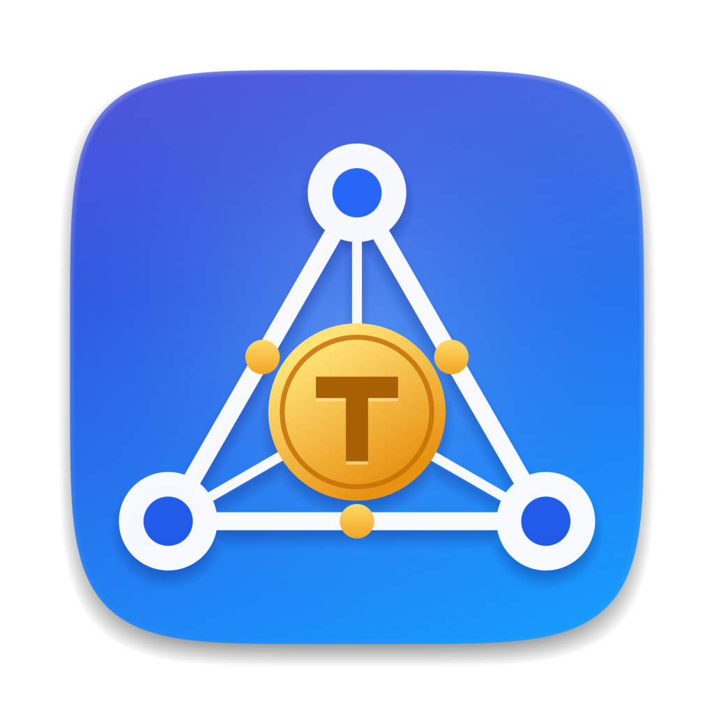

<p align="center">
  
</p>

<h1 align="center">Token Share</h1>

<p align="center">
  Pool your <a href="https://ollama.com">ollama</a> machines. Point any ollama client at any
  one of them, and the request is served locally or streamed from a peer that has the model.
</p>

---

You have a GPU box with the big models, a laptop with a couple of small ones, and
maybe a machine with none at all. Token Share makes them behave like one ollama:
every machine runs a small peer-to-peer **delegate**, delegates discover each other
and trade the list of models they hold, and a request to any delegate is routed to
whichever machine has the model and a free slot.

- **Drop-in.** It speaks ollama's native and OpenAI-compatible APIs, so the
  `ollama` CLI (`ls`, `run`, `show`, `ps`) and OpenAI-style clients such as
  OpenCode work unchanged; with [masquerade](docs/configuration.md#masquerade) it
  even listens on ollama's own port, 11434.
- **Streams, doesn't buffer.** Tokens are passed through as they are produced, so
  first-token latency matches talking to ollama directly. A client disconnect
  cancels the generation upstream.
- **No coordinator.** There is no server to run. Delegates gossip membership and
  keepalives, repair each other's tables, and age out dead peers.
- **Clients and donors.** A machine with no ollama can just consume the pool
  (*client-only*); a machine can also use the pool without lending its own ollama
  (*not sharing*).
- **Observable.** Every proxied response logs how it ended, so "the stream ended
  without a finish_reason" can be traced to a cause instead of guessed at.
- **Native tray apps** for macOS and Windows with status icons and a settings
  window; a headless daemon (and a `.deb`) for Linux.

```
   your app / ollama CLI
            │  ollama or OpenAI API
            ▼
   ┌─────────────────┐  model here and a free slot?  ┌──────────────┐
   │ delegate (you)  │ ────────── yes ─────────────▶ │ local ollama │
   └────────┬────────┘                               └──────────────┘
            │ no: stream it from a peer that has the model
            ├────────────────────────┐
            ▼                        ▼
   ┌─────────────────┐      ┌─────────────────┐
   │ delegate (GPU)  │ ◀──▶ │ delegate (lab)  │   delegates gossip membership,
   │  └─ ollama      │      │  └─ ollama      │   models and keepalives
   └─────────────────┘      └─────────────────┘
```

## Quick start

Build it from a checkout of this repository (you need a recent stable
[Rust](https://rustup.rs) toolchain):

```bash
cargo build --release          # target/release/tokenshare (and tokenshare-tray)
```

On the machine that has the models and ollama running:

```bash
./target/release/tokenshare
```

On any other machine on the same network, join through the first one (replace
`gpu-box` with its address; the port is 11343):

```bash
./target/release/tokenshare --client-only --fc http://gpu-box:11343
```

Now use the pool from that second machine:

```bash
export OLLAMA_HOST=http://localhost:11343
ollama ls                      # lists the models on every delegate
ollama run llama3.2 "hello"    # served by whichever delegate has it
```

To keep apps that already talk to `localhost:11434` working with no changes, add
`--masquerade` (and run your own ollama on another port, see
[masquerade](docs/configuration.md#masquerade)). `tokenshare delegates` shows who
the machine knows about.

## Install

There are no binary releases yet, so build from source. Scripts package the result:

| Platform | Command | Output |
| --- | --- | --- |
| macOS | `packaging/macos/build-app.sh` | `Token Share.app`, a menubar-only app |
| Windows (x64) | `packaging/windows/build-zip.sh` | a zip with the taskbar app, the daemon and `WebView2Loader.dll` |
| Linux (x64) | `packaging/linux/build-deb.sh` | a `.deb` with the daemon, a systemd user unit and a man page |

Details and prerequisites: [Building and packaging](docs/packaging.md). On Linux
see also the [Linux guide](docs/linux.md).

## Configuration

Everything is optional and lives in one TOML file; flags override it. The settings
you will reach for first:

| Key | Default | |
| --- | --- | --- |
| `fc` | none | a delegate to join through at startup |
| `ollama_hosts` | `["http://localhost:11434"]` | ollama instances on this machine; `[]` for a client-only delegate |
| `pool_size` | `3` | concurrent requests sent to the local ollama |
| `share_with_peers` | `true` | let others use this machine's ollama |
| `masquerade` | `false` | also listen on ollama's port, 11434 |
| `port` | `11343` | where delegates (and, without masquerade, clients) connect |

Full reference, file locations and the tray app's settings window:
[Configuration](docs/configuration.md).

## How it works

- **Membership.** Each delegate keeps a persisted table of every delegate: URL,
  status, models, `last_seen`. A newcomer asks any delegate for its table, and the
  rest hear about it by announcement. There is no leader.
- **Keepalives and sync.** Every delegate sends a keepalive carrying its models to a
  random peer, which relays it a few hops. Peers that stop answering are marked
  unavailable and return only on a fresh keepalive. Periodic full-table pulls repair
  anything gossip missed, with the later `last_seen` winning.
- **Routing.** The delegate reads `model` from the request, serves it from its own
  ollama if it has the model and a free slot, and otherwise tries online peers that
  have it in random order. Forwarded requests carry a header so they are never
  forwarded twice.
- **Streaming and failure.** The request body is buffered so it can be replayed to
  the next peer, but responses never are. A request is retried on another peer only
  before the first byte; once streaming has started, an upstream failure breaks the
  client connection so a truncated reply is never mistaken for a complete one.

More: [How it works](docs/how-it-works.md) (protocol, streaming, stale delegates,
shutdown) and [Ollama compatibility](docs/ollama-compatibility.md) (exactly which
endpoints are routed, and what the `ollama` CLI needs from a server).

## Observability

Every proxied response logs one line when it ends, including how it ended, how long
it took, and the token counts from the final chunk, never any content. For example,
a response whose upstream stopped without a final chunk:

```
WARN response model="qwen3:14b" route="peer" outcome="complete" problem="no_final_chunk" bytes=176 ttfb_ms=7120 total_ms=7144 upstream_message="llama runner process has terminated"
```

`GET /_ts/status` returns the delegate's state and table as JSON. See
[Logging](docs/logging.md).

## Limitations and security

- **There is no authentication and no encryption.** Run it only on a network you
  trust (a LAN, or a VPN such as Tailscale) and never expose the port to the
  internet. Anyone who can reach a delegate can use every model in the pool and
  join the mesh.
- **Full mesh.** Every delegate knows every other, so this is for a handful to a
  few dozen machines, not thousands.
- **Load balancing is random**, not load-aware; there is no GPU/CPU awareness.
- **Clocks matter a little.** Table merges compare `last_seen` timestamps from
  different machines, so keep them roughly in sync with NTP.
- **Not every endpoint is pooled.** `pull`, `create`, `delete` and friends only act
  on a machine's own ollama.
- **Peer models in `ollama ls` show size `0 B`** and a stand-in ID, because only
  names are shared between delegates.

## Status

This is early software, version 0.1. It was built and exercised mainly on **macOS
(Apple Silicon)**. The Windows and Linux builds are cross-compiled and a CI workflow
for all three platforms is included, but they have had far less hands-on use. Bug
reports with the `response` log lines around the problem are the most useful kind.

## Development

```bash
cargo test                                  # unit tests plus multi-node integration tests
cargo clippy --all-targets -- -D warnings
cargo fmt --all --check
```

The integration tests start several delegates and mock ollamas in-process, including
killing and restarting nodes. Layout, the original design sketch and the decision
log are in [Building and packaging](docs/packaging.md#repository-layout) and
[`design/`](design/).

## License

[MIT](LICENSE).
